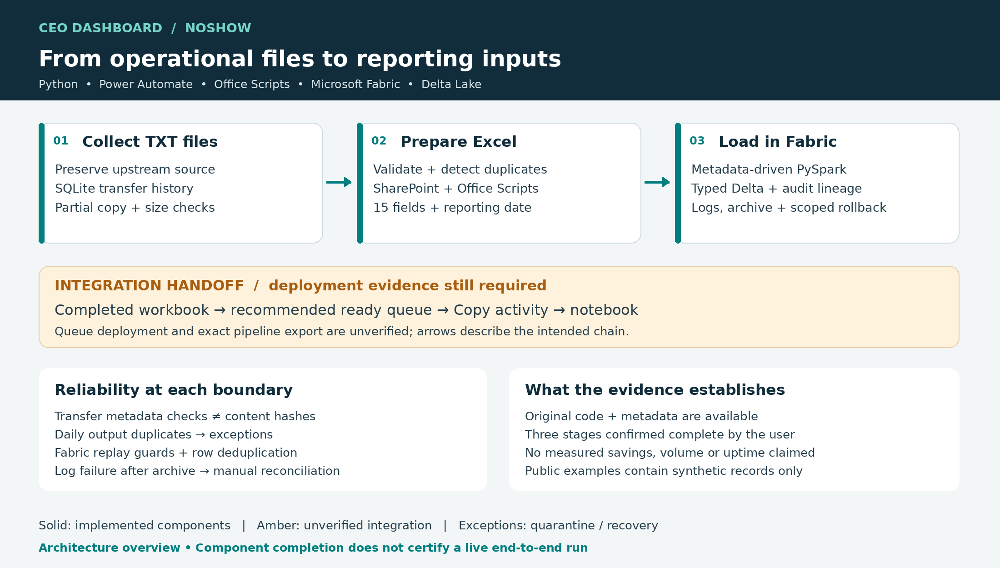
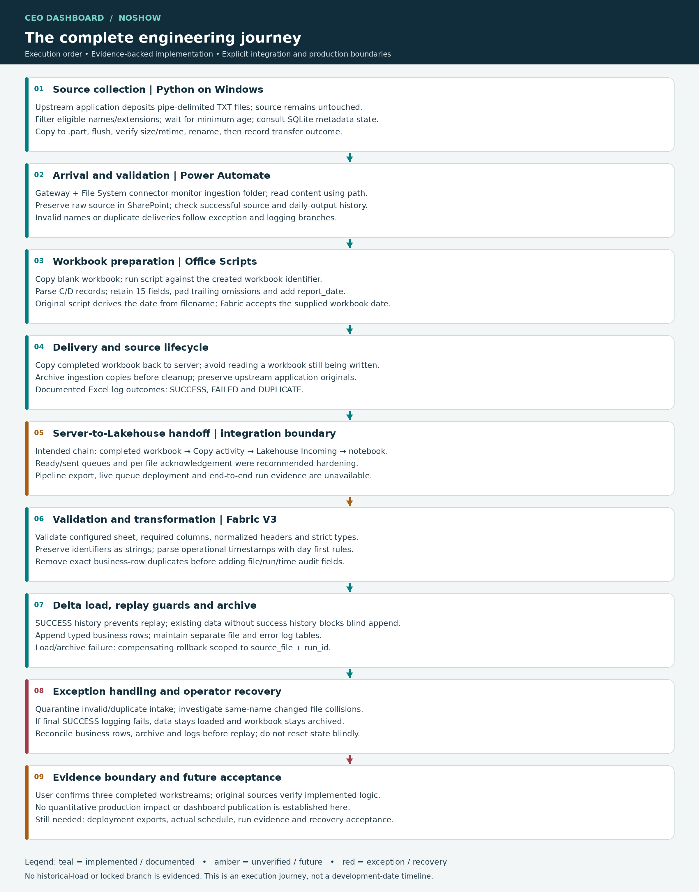
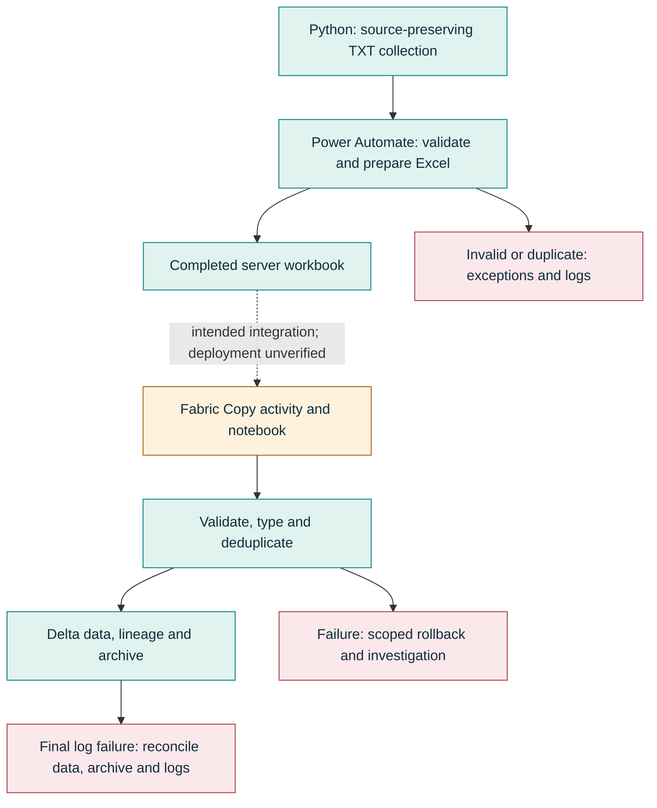

# CEO Dashboard · NoShow Data Platform

**Python collection → automated workbook preparation → metadata-driven Lakehouse ingestion.**

A NoShow data-engineering workstream within the CEO Dashboard programme at Aga Khan University Hospital. It brings together on-premises file automation, Microsoft 365 workflows and Microsoft Fabric. The user confirms the three workstreams are complete; original artifacts support the implemented controls. Live integration deployment and quantitative production outcomes are not independently evidenced.






## Why this work matters
Operational reporting begins with files that may be repeated, incomplete or difficult to parse. This work turns pipe-delimited inputs into a typed, traceable reporting dataset while making exceptions and recovery visible. No patient-outcome improvement, no-show reduction, time saving or throughput figure is claimed.

## Engineering capabilities
- Source-preserving collection with SQLite transfer state and partial-copy validation.
- Power Automate orchestration, SharePoint staging and Office Scripts workbook preparation.
- JSON-driven PySpark mappings, explicit types and workbook/schema validation.
- Separate duplicate controls at transfer, daily-output, filename and exact-row boundaries.
- File/run/time lineage, operational logs, success archives and scoped compensating rollback.
- Explicit recovery for data-loaded/archive-complete/success-log-failed states.

## What is included
| Path | Purpose / provenance |
|---|---|
| src/transfer.py | Sanitized derivative of original transfer source |
| office-scripts/ | Sanitized original-derived Excel automation code |
| fabric/ | Sanitized original-derived V3 notebook source and precheck |
| config/ | Fabric derivative and reconstructed transfer configuration example |
| src/reference_demo.py | Newly reconstructed local synthetic demonstration |
| tests/ and sample_data/ | Synthetic replay, parsing, failure and transfer checks |
| docs/portfolio/ | Wrap-up, LinkedIn, resume and evidence register |
| docs/images/ | Deterministic architecture diagrams |

## Run a safe local demonstration
Python 3.9+; the demo and tests use the standard library. Run from repository root:

```bash
python -m src.reference_demo --source sample_data/DEMO-NOSHOWDATA-20260115100000.txt --output local_output/demo
python -m src.reference_demo --source sample_data/DEMO-NOSHOWDATA-20260115100000.txt --output local_output/demo
python -m unittest discover -s tests -v
python -m compileall -q src fabric
```
First demo run loads one deduplicated synthetic row; repeat reports DUPLICATE. This is local test evidence, not production throughput. Output is ignored by Git. The CSV/SQLite demonstration does not emulate distributed Delta transactions.

To exercise the transfer derivative, copy config/config.example.json to config/config.json, create its local destination directory and run python src/transfer.py. Use only synthetic local paths. For Fabric/Excel services, see their runtime notes and validate in a development environment.

## Reliability and limits
Metadata-based transfer history is not content hashing. Daily-output duplicate checks may block a legitimate corrected file until reviewed. Exact-row dedup is within one workbook. Replay guards do not imply global business-key uniqueness, distributed exactly-once delivery or safe concurrent notebook runs. Final success-log failure leaves loaded data and archived input for reconciliation.

## Evidence and governance
See [provenance](docs/ARTIFACT_PROVENANCE.md), [evidence register](docs/portfolio/EVIDENCE_REGISTER.md), [operations](docs/OPERATIONS.md), [data contract](docs/DATA_CONTRACT.md) and [research](docs/RESEARCH.md). No authoritative Power Automate or Fabric pipeline export, scheduler XML, production extract or historical Git repository was available. Queue deployment and per-file acknowledgement remain unverified. No original deployment credentials or confidential records are included.

Public examples are sanitized derivatives or clearly marked reconstructions. They do not certify production readiness or grant rights to organizational material. Confirm publication rights and final disclosure review before public upload. Nothing in this package was published remotely.

## Future opportunities
Capture deployment exports and measured run evidence; validate ready/sent handoff, recovery scenarios and concurrency; instrument end-to-end latency and processing counts. Website-ready and interview material lives in the separate handoff, not a published website.
